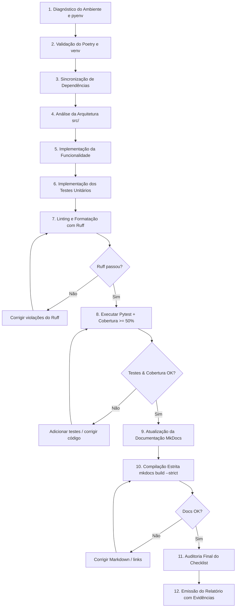

# SKILL: Padrões de Engenharia de Software para Projetos Python

> **Perfil do Operador:** Engenheiro de Software Python Sênior  
> **Objetivo:** Estabelecer diretrizes operacionais, arquiteturais e de qualidade não-negociáveis para que agentes de IA desenvolvam, mantenham, testem e documentem projetos Python com reprodutibilidade estrita, automação e excelência técnica.

---

## 1. Princípios Operacionais Inegociáveis

Toda IA atuando sob esta especificação deve aderir estritamente aos seguintes postulados:

1. **Evidência Operacional:** Nenhuma tarefa é declarada concluída sem execução real dos comandos de validação e apresentação dos outputs de terminal no relatório.
2. **Sem Falso Positivo:** É proibido criar testes "de fachada" apenas para inflar cobertura de código ou desativar regras de linter sem justificativa técnica fundamentada.
3. **Isolamento e Reprodutibilidade:** Nenhuma ferramenta ou pacote pode ser instalado ou executado globalmente. Todo o ciclo de vida depende exclusivamente do ambiente virtual gerenciado pelo Poetry.
4. **Respeito à Falha:** Se qualquer etapa de validação (lint, formatação, teste, cobertura ou compilação de docs) retornar código de saída diferente de zero, a tarefa está **bloqueada** até a resolução do problema.

---

## 2. Gerenciamento de Ambiente e Dependências

O projeto utiliza a tríade **`pyenv` + `Poetry` + `venv do Poetry`**.

```
                +-------------------+
                |       pyenv       |  -> Controla a versão do runtime Python (.python-version)
                +---------+---------+
                          |
                          v
                +-------------------+
                |      Poetry       |  -> Gerencia dependências, metadados e lockfile
                +---------+---------+
                          |
                          v
                +-------------------+
                | Virtualenv Local  |  -> Isola pacotes e binários executáveis
                +-------------------+
```

### 2.1 Regras de Ambiente
1. **Controle de Versão do Python:** A versão base deve ser definida via `pyenv` e fixada no arquivo `.python-version` na raiz do repositório.
2. **Compatibilidade no `pyproject.toml`:** A restrição em `requires-python` (ou `tool.poetry.dependencies.python`) deve ser consistente com a versão especificada no `.python-version`.
3. **Ambiente Virtual Exclusivo:** O ambiente virtual deve ser criado e gerenciado pelo Poetry (`poetry env use <python-path>`). Não utilize `conda`, `virtualenv` manual ou `venv` avulso.
4. **Instalação Isolada:** Nunca execute `pip install` diretamente na máquina host. Use unicamente `poetry add` ou `poetry install`.
5. **Rastreabilidade no Git:** O arquivo `poetry.lock` **deve obrigatoriamente** ser versionado no Git para garantir builds determinísticos entre ambientes de desenvolvimento e CI/CD.
6. **Execução Contextualizada:** Todos os utilitários de CLI (`pytest`, `ruff`, `mkdocs`, etc.) devem ser executados através de `poetry run <comando>` ou dentro de um subshell ativo com `poetry shell`.

### 2.2 Guia de Comandos do Ambiente

| Operação | Comando | Descrição Técnica |
| :--- | :--- | :--- |
| **Definir versão local** | `pyenv local 3.12.2` | Cria/atualiza o arquivo `.python-version` no diretório corrente. |
| **Vincular Poetry ao Python** | `poetry env use $(pyenv which python)` | Aponta o ambiente virtual do Poetry para o binário exato do pyenv. |
| **Instalar dependências** | `poetry install` | Instala pacotes do `poetry.lock` (ou resolve `pyproject.toml` se lock inexistente). |
| **Adicionar dep. de produção** | `poetry add <pacote>` | Insere dependência no escopo principal do `pyproject.toml`. |
| **Adicionar dep. de desenvolvimento** | `poetry add -G dev <pacote>` | Insere dependência no grupo `dev` (ferramental de testes, linter, docs). |
| **Atualizar lockfile** | `poetry lock --no-update` | Atualiza o `poetry.lock` refletindo mudanças manuais no `pyproject.toml`. |
| **Inspecionar ambiente** | `poetry env info` | Exibe caminho do executável Python e diretório do virtualenv ativo. |

---

## 3. Estrutura Canônica do Projeto (`src/` layout)

Adota-se obrigatoriamente o layout `src/`, que previne importações acidentais do diretório de desenvolvimento e assegura que os testes importem o pacote instalado no ambiente virtual:

```text
projeto/
├── .gitignore                     # Ignora venvs, caches, artefatos de build e cobertura
├── .python-version                # Versão exata do Python controlada pelo pyenv
├── pyproject.toml                 # Configuração unificada do projeto e ferramentas
├── poetry.lock                    # Árvore de dependências resolvida com hashes SHA-256
├── README.md                      # Apresentação, badges, instruções básicas e quickstart
├── SKILL.md                       # Este guia de padrões operacionais
├── mkdocs.yml                     # Configuração do site de documentação MkDocs Material
├── src/
│   └── projeto/                   # Pacote Python principal (substituir pelo nome do projeto)
│       ├── __init__.py            # Marcação do pacote e exposição de versão (__version__)
│       ├── core/                  # Módulos com regras de negócio e domínio
│       │   ├── __init__.py
│       │   └── ...
│       ├── clients/               # Clientes de APIs, integrações externas ou banco de dados
│       │   ├── __init__.py
│       │   └── ...
│       └── utils/                 # Helpers, formatadores e rotinas auxiliares puras
│           ├── __init__.py
│           └── ...
├── tests/
│   ├── __init__.py
│   ├── conftest.py                # Fixtures compartilhadas, mocks globais e hooks do pytest
│   ├── unit/                      # Testes unitários puros (rápidos e sem I/O real)
│   │   ├── __init__.py
│   │   └── ...
│   └── integration/               # Testes de integração (fluxos de componentes)
│       ├── __init__.py
│       └── ...
└── docs/
    ├── index.md                   # Home da documentação técnica
    ├── setup.md                   # Instruções detalhadas de ambiente e instalação
    ├── architecture.md            # Arquitetura, diagramas e decisões de design (ADRs)
    ├── api_reference.md           # Referência dos módulos e funções
    └── testing.md                 # Guia de execução de testes e métricas de qualidade
```

---

## 4. Qualidade de Código e Formatação com Ruff

O **Ruff** é o linter e formatador estático padrão e obrigatório, substituindo Flake8, Black, isort e Bandit em uma única ferramenta de alta performance.

### 4.1 Diretrizes de Qualidade
- **Configuração Centralizada:** Todas as regras e exclusões ficam em `[tool.ruff]` dentro de `pyproject.toml`.
- **Import Sorting Automático:** O Ruff organiza automaticamente os imports conforme convenção (Built-in -> Third-party -> First-party -> Local).
- **Correção Proativa:** Problemas que possuem autofix devem ser corrigidos imediatamente com `--fix`.
- **Proibição de `noqa` Indiscriminado:** Supressões `# noqa` só são aceitas se acompanhadas de comentário técnico explicando a impossibilidade de refatoração imediata.

### 4.2 Comandos Obrigatórios de Lint e Formatação

```bash
# 1. Analisar inconsistências e violações de código
poetry run ruff check .

# 2. Aplicar correções automáticas seguras
poetry run ruff check . --fix

# 3. Formatar todo o código-fonte conforme as convenções
poetry run ruff format .

# 4. Validar se a formatação está em conformidade (modo estrito / CI)
poetry run ruff format --check .
```

---

## 5. Testes Automatizados com Pytest e Cobertura Mínima

O projeto deve ser coberto por suítes de testes automatizados com execução determinística, rápida e independente de serviços externos.

### 5.1 Requisitos de Implementação dos Testes
1. **Separação de Contextos:** Testes unitários residem em `tests/` e nunca junto do código de produção.
2. **Isolamento Absoluto:** Testes não dependem de conexão com internet, banco de dados externo ou arquivos com caminhos absolutos do host. Use `unittest.mock`, `pytest-mock` e fixtures do pytest (`tmp_path`, `monkeypatch`).
3. **Escopo dos Casos de Teste:** Toda funcionalidade implementada deve cobrir:
   - Caminho Feliz (*Happy path* com dados válidos).
   - Entradas Inválidas e Limítrofes (*Boundary conditions* e valores fora da faixa esperada).
   - Tratamento de Exceções (verificar se `pytest.raises` captura a exceção correta sob erro).
4. **Parametrização:** Use `@pytest.mark.parametrize` para testar múltiplos cenários sem duplicar blocos de código.

### 5.2 Regra de Cobertura de Código (Mínimo de 50%)
- **Métrica Inegociável:** A cobertura de código do pacote em `src/projeto/` deve ser de **no mínimo 50%**.
- **Travamento Automático:** Utiliza-se a flag `--cov-fail-under=50` do `pytest-cov`. Caso a cobertura fique em 49.9% ou inferior, o comando retorna código de erro e o processo é interrompido.
- **Transparência de Evidências:** A IA deve rodar o comando e colar a tabela do relatório de cobertura (`term-missing`) no sumário final da entrega.

### 5.3 Comandos Oficiais de Teste e Cobertura

```bash
# Execução padrão de todos os testes
poetry run pytest

# Execução detalhada com relatório de cobertura no terminal
poetry run pytest --cov=projeto --cov-report=term-missing

# Validação estrita obrigatória com enforcement de cobertura mínima (>= 50%)
poetry run pytest --cov=projeto --cov-report=term-missing --cov-fail-under=50
```

---

## 6. Documentação Técnica com MkDocs Material

A documentação deve ser tratada como código (*Docs as Code*), versionada em Markdown e renderizada com **MkDocs** usando o tema **Material for MkDocs**.

### 6.1 Requisitos de Documentação
1. **Estrutura:** O site de documentação deve ser configurado no arquivo `mkdocs.yml` na raiz do projeto.
2. **Ponto de Entrada:** O arquivo `docs/index.md` deve conter visão geral do projeto, objetivos, pré-requisitos e atalhos de navegação.
3. **Conteúdo Obrigatório:**
   - Instalação e configuração de ambiente.
   - Exemplos reais de uso e chamadas das funções/APIs principais.
   - Visão de arquitetura e decisões de projeto.
   - Instruções de teste e contribuição.
4. **Build Estrito (`--strict`):** A documentação deve compilar sem avisos ou links quebrados. O comando `build --strict` trata qualquer advertência como erro fatal.

### 6.2 Comandos do MkDocs

```bash
# Iniciar servidor local de desenvolvimento com hot-reload (http://127.0.0.1:8000)
poetry run mkdocs serve

# Compilar documentação em modo estrito (valida sintaxe, links e estrutura)
poetry run mkdocs build --strict

# Publicar no GitHub Pages (executar somente sob aprovação/configuração explícita)
poetry run mkdocs gh-deploy
```

---

## 7. Configuração Centralizada no `pyproject.toml`

Abaixo está o arquivo de configuração de referência, integrando todas as ferramentas sem duplicação:

```toml
[project]
name = "projeto"
version = "0.1.0"
description = "Projeto Python profissional desenvolvido sob padrões de engenharia de software"
authors = [
    { name = "Equipe de Engenharia", email = "dev@empresa.com" }
]
readme = "README.md"
requires-python = ">=3.12"
dependencies = [
    "pydantic>=2.7.0",
    "requests>=2.31.0",
]

[tool.poetry]
packages = [{ include = "projeto", from = "src" }]

[tool.poetry.group.dev.dependencies]
pytest = ">=8.2.0"
pytest-cov = ">=5.0.0"
pytest-mock = ">=3.14.0"
ruff = ">=0.4.0"
mkdocs = ">=1.6.0"
mkdocs-material = ">=9.5.0"

[build-system]
requires = ["poetry-core>=2.0.0,<3.0.0"]
build-backend = "poetry.core.masonry.api"

# ---------------------------------------------------------
# Configuração do Ruff (Linter e Formatter)
# ---------------------------------------------------------
[tool.ruff]
target-version = "py312"
line-length = 88
src = ["src", "tests"]

[tool.ruff.lint]
select = [
    "E",      # pycodestyle erros
    "W",      # pycodestyle avisos
    "F",      # pyflakes
    "I",      # isort (organização de imports)
    "B",      # flake8-bugbear
    "C4",     # flake8-comprehensions
    "UP",     # pyupgrade (sintaxe moderna)
    "ARG",    # flake8-unused-arguments
    "SIM",    # flake8-simplify
    "PTH",    # flake8-use-pathlib
]
ignore = [
    "E501",   # Comprimento de linha delegado ao formatador
]

[tool.ruff.lint.isort]
known-first-party = ["projeto"]

[tool.ruff.format]
quote-style = "double"
indent-style = "space"
skip-magic-trailing-comma = false
line-ending = "auto"

# ---------------------------------------------------------
# Configuração do Pytest e Cobertura
# ---------------------------------------------------------
[tool.pytest.ini_options]
minversion = "8.0"
testpaths = ["tests"]
pythonpath = ["src"]
addopts = [
    "-ra",
    "--strict-markers",
    "--strict-config",
]

[tool.coverage.run]
branch = true
source = ["src/projeto"]
omit = [
    "*/__init__.py",
    "*/tests/*",
]

[tool.coverage.report]
show_missing = true
skip_covered = false
fail_under = 50
exclude_lines = [
    "pragma: no cover",
    "def __repr__",
    "if TYPE_CHECKING:",
    "raise NotImplementedError",
    "if __name__ == .__main__.:",
]
```

### 7.1 Configuração Base do `mkdocs.yml`

```yaml
site_name: Documentação do Projeto
site_description: Documentação técnica completa e guias de uso.
theme:
  name: material
  language: pt-BR
  palette:
    - scheme: default
      primary: indigo
      accent: indigo
      toggle:
        icon: material/brightness-7
        name: Mudar para modo escuro
    - scheme: slate
      primary: indigo
      accent: indigo
      toggle:
        icon: material/brightness-4
        name: Mudar para modo claro
  features:
    - navigation.instant
    - navigation.sections
    - navigation.top
    - search.suggest
    - search.highlight
    - content.code.copy

nav:
  - Início: index.md
  - Instalação e Setup: setup.md
  - Arquitetura: architecture.md
  - Testes e Qualidade: testing.md

plugins:
  - search
```

---

## 8. Fluxo Operacional Obrigatório da IA (Step-by-Step)

Toda interação que envolva criação, modificação ou refatoração no projeto **deve** seguir este roteiro de 12 etapas:



### Detalhamento das Etapas:
1. **Inspeção de Runtime:** Conferir arquivo `.python-version` e confirmar se o interpretador local ativo corresponde à versão requerida.
2. **Validação do Poetry:** Executar `poetry env info` e checar integridade do `pyproject.toml` e do `poetry.lock`.
3. **Sincronização:** Rodar `poetry install` caso novas dependências tenham sido adicionadas.
4. **Arquitetura Modular:** Identificar onde o novo código deve ser inserido dentro de `src/projeto/`, respeitando o princípio de responsabilidade única (SRP).
5. **Codificação:** Escrever código tipado (`type hints`), com tratamento defensivo de exceções e sem efeitos colaterais globais.
6. **Construção de Testes:** Criar testes em `tests/` cobrindo cenários de sucesso, erro e casos de borda para as novas funções/classes.
7. **Formatação e Linting:**
   - Rodar `poetry run ruff check . --fix`
   - Rodar `poetry run ruff format .`
   - Validar com `poetry run ruff format --check .`
8. **Validação de Testes e Cobertura:**
   - Rodar `poetry run pytest --cov=projeto --cov-report=term-missing --cov-fail-under=50`
   - Conferir se nenhuma linha crítica de lógica ficou de fora.
9. **Atualização Documental:** Adicionar ou atualizar guias e referências em `docs/` e ajustar a chave `nav` em `mkdocs.yml` se houver páginas novas.
10. **Build Estrito de Documentação:**
    - Executar `poetry run mkdocs build --strict`
    - Garantir saída limpa com zero avisos.
11. **Retrabalho Iterativo:** Se qualquer comando anterior falhar, corrigir a causa raiz e reiniciar as validações pertinentes.
12. **Apresentação ao Usuário:** Apresentar relatório executivo detalhando o que foi alterado e as evidências reais de sucesso de cada comando.

---

## 9. Boas Práticas de Código e Segurança

### 9.1 Engenharia de Código
- **Type Annotations Estritas:** Todas as assinaturas de funções e métodos públicos devem declarar tipos de argumentos e retorno (`def process_lap(lap_id: int) -> dict[str, Any]:`).
- **Docstrings Concisas:** Utilizar padrão Google ou PEP 257 em módulos, classes e funções públicas, explicando o propósito, parâmetros (`Args:`), retorno (`Returns:`) e exceções disparadas (`Raises:`).
- **Tratamento de Exceções Semântico:** Crie classes de exceção específicas do domínio herdando de `Exception` (ex: `class TelemetrySyncError(Exception): pass`). Nunca use `except Exception: pass`.
- **Separação I/O vs Lógica Pura:** Funções que calculam métricas ou processam regras de negócio devem ser isoladas de chamadas de rede ou leituras de disco.

### 9.2 Segurança e Segredos
- **Proibição de Hardcoded Secrets:** Chaves de API, senhas, tokens ou URLs de bancos nunca devem constar no código. Utilize variáveis de ambiente gerenciadas via arquivo `.env` (ignorado no Git).
- **Arquivo `.gitignore` Completo:** Garantir que o repositório ignore:
  ```gitignore
  # Ambientes virtuais
  .venv/
  env/
  venv/

  # Cache de bytecode Python
  __pycache__/
  *.py[cod]

  # Pytest e Cobertura
  .pytest_cache/
  .coverage
  htmlcov/

  # Ruff e Linter
  .ruff_cache/

  # MkDocs artefatos
  site/

  # Segredos e variáveis de ambiente
  .env
  *.key
  *.pem
  ```

---

## 10. Diagnóstico e Resolução de Problemas Comuns

| Sintoma | Causa Raiz | Procedimento de Correção |
| :--- | :--- | :--- |
| `ModuleNotFoundError: No module named 'projeto'` durante os testes | O pytest não identificou o diretório `src/` no `PYTHONPATH`. | Verificar se `pythonpath = ["src"]` está configurado no bloco `[tool.pytest.ini_options]` do `pyproject.toml`. |
| `FAIL Required test coverage of 50% not reached` | Cobertura insuficiente do código novo adicionado. | Rodar `poetry run pytest --cov=projeto --cov-report=term-missing`, identificar as linhas marcadas na coluna `Missing` e implementar testes específicos para esses ramos. |
| Erro no `mkdocs build --strict` apontando link quebrado | Um link Markdown aponta para arquivo ou âncora inexistente em `docs/`. | Corrigir a referência relativa para o arquivo correto ou registrar a nova página no `mkdocs.yml`. |
| Conflito de versão no `poetry install` | Restrições incompatíveis de dependências no `pyproject.toml`. | Executar `poetry lock --no-update` para reavaliar a árvore de dependências ou flexibilizar restrições muito rígidas. |
| Ruff formata com aspas simples ou largura divergente | Conflito de configuração nas seções de formatação. | Garantir que `line-length = 88` e `quote-style = "double"` estejam centralizados em `[tool.ruff]`. |

---

## 11. Checklist Operacional de Entrega

Antes de responder ao usuário declarando a tarefa como concluída, o agente deve auditar os seguintes itens:

- [ ] Arquivo `.python-version` existe e reflete a versão adequada.
- [ ] Dependências declaradas exclusivamente no `pyproject.toml` e instaladas via Poetry.
- [ ] Código novo organizado sob o padrão `src/projeto/`.
- [ ] Testes implementados cobrindo cenários positivos, negativos e bordas em `tests/`.
- [ ] `poetry run ruff check .` executado com **zero erros**.
- [ ] `poetry run ruff format --check .` executado com **zero modificações pendentes**.
- [ ] `poetry run pytest --cov=projeto --cov-fail-under=50` executado com **100% de aprovação e cobertura >= 50%**.
- [ ] Páginas de documentação atualizadas em `docs/` e refletidas em `mkdocs.yml`.
- [ ] `poetry run mkdocs build --strict` executado com **sucesso e zero warnings**.
- [ ] Arquivo `.gitignore` validado (sem credenciais, caches ou venvs no Git).
- [ ] Relatório final gerado contendo o sumário das ações e outputs reais verificados.

