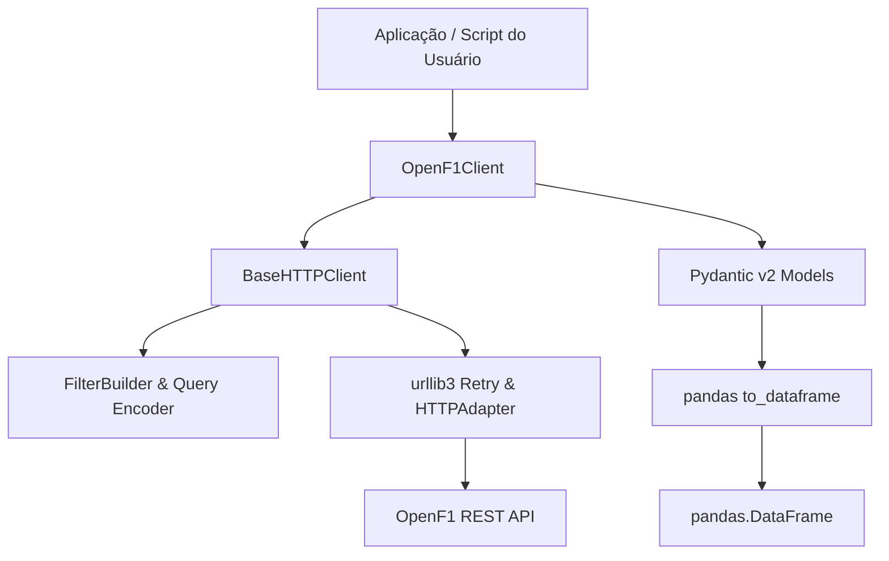

# Arquitetura e Decisões de Design

A biblioteca **`f1`** adota o layout canônico `src/`, garantindo separação rigorosa de responsabilidades entre transporte de rede, validação de domínio e rotinas analíticas.

---

## Diagrama da Arquitetura em Camadas

---

## Estrutura dos Módulos

### 1. Camada de Domínio (`src/f1/core/`)
- **`models.py`:** Define classes de dados herdadas de `OpenF1BaseModel` para cada um dos 18 endpoints da OpenF1. Possuem configuração com `extra="ignore"` e validação de tipos opcionais, arrays de telemetria e formatos cronológicos.
- **`constants.py`:** Enums tipados para status de DRS (`DRSStatus`), compostos de pneus (`TyreCompound`), bandeiras da direção de prova (`FlagType`) e categorias de sessões (`SessionType`).
- **`filters.py`:** Motor de tradução de filtros do Python para query strings da API, suportando operadores relacionais (`__gte`, `__lte`, `__gt`, `__lt`), valores múltiplos e preservação de caracteres seguros na URL.

### 2. Camada de Comunicação de Rede (`src/f1/clients/`)
- **`base.py` (`BaseHTTPClient`):** Responsável pelo gerenciamento do pool de conexões com `requests.Session`, políticas defensivas de retries com backoff exponencial para códigos 429 e 5xx, controle de timeouts e tradução de falhas para exceções de domínio.
- **`openf1.py` (`OpenF1Client`):** Especialização de alto nível que oferece métodos semânticos para cada endpoint, como `get_car_data()`, `get_laps()`, `get_weather()`, etc.

### 3. Camada de Utilitários (`src/f1/utils/`)
- **`dataframe.py`:** Converte listas de modelos Pydantic ou payloads CSV diretamente em objetos `pandas.DataFrame`.
- **`datetime.py`:** Normaliza e converte representações de timestamps ISO 8601 UTC.

### 4. Camada de Exceções (`src/f1/exceptions.py`)
- `OpenF1Exception`: Classe mãe para capturas genéricas.
- `OpenF1APIError`: Disparada sob falhas de código HTTP 4xx ou 5xx.
- `OpenF1ConnectionError`: Disparada sob desconexão ou timeout.
- `OpenF1ValidationError`: Disparada sob dados de entrada ou respostas inválidas.

